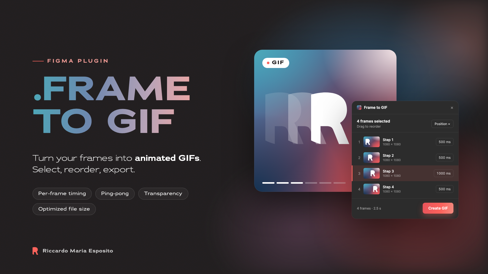

# Frame to GIF — Figma plugin

Export one or more Figma frames as an animated GIF. Each selected frame becomes one frame of the animation.
No dependencies, no build step and no network requests: the GIF is encoded inside the plugin.

## Install (development)

1. Open the **Figma desktop app** (development plugins can only be imported there).
2. Go to **Plugins → Development → Import plugin from manifest…**
3. Pick `manifest.json` in this folder.
4. Run it from **Plugins → Development → Frame to GIF**.

## Usage

1. Select frames on the canvas (frames, components, instances or groups).
   - If you select a **Section** or a **variant set**, the frames inside it become the animation frames.
   - If you select a single frame that contains other frames, you can turn on "Use the frames inside as animation frames".
2. Choose the order: **Position** (rows from the top, then left to right), **Name** (natural order: 2 before 10), **Layers**, or drag the rows.
3. Set the duration: one value for all frames, a value per frame in the list, or in the frame name with `[300ms]` or `[1.5s]`.
4. **Create GIF** → preview → **Download GIF** or **Insert into Figma** (places it on the canvas next to your frames).

## Options

| Option | What it does |
|---|---|
| Scale | 0.5× – 3× the frame size |
| Loop | Forever, Once, or N times |
| Colors | Maximum colors per palette (a GIF supports up to 256). If the design uses fewer, colors stay exact |
| Palette | *One for the whole GIF*: same colors in every frame (no flicker). *One per frame*: better quality when frames are very different |
| Background | Color used behind transparent areas |
| Dithering | Smooths gradients when there aren't enough colors (Floyd–Steinberg) |
| Transparent background | Keeps transparency (GIF pixels are either fully opaque or fully transparent, so soft edges become hard) |
| Optimize size | Only encodes the area that changes between frames; identical frames are merged |
| Ping-pong | Plays forward, then backward |

If frames have different sizes, the GIF uses the largest size and centers each frame.

## Privacy

The plugin makes no network requests (`networkAccess` is `none` in the manifest). It only stores your settings (duration, scale, colors…) in `figma.clientStorage`, on your machine.

## Project structure

- `manifest.json` — plugin configuration
- `code.js` — runs in Figma's sandbox: reads the selection, exports frames as PNG, inserts the GIF on the canvas
- `ui.html` — the interface and the GIF encoder (median-cut quantization, dithering, LZW)
- `test/harness.html` — a page that simulates Figma so you can try the UI in a browser:
  run `python3 -m http.server 8765` in this folder, then open `http://localhost:8765/test/harness.html`
- `assets/` — Community cover and icon, plus the HTML files they are rendered from

## Publishing

The `id` in `manifest.json` (`1692883926141543504`) is the one Figma assigned to this plugin: don't change it, or Figma will treat it as a different plugin. To publish: **Plugins → Development → Frame to GIF → Publish**, with `assets/icon-128.png` as the icon and `assets/cover.png` as the cover.

## License

[MIT](LICENSE) © 2026 Riccardo Maria Esposito
